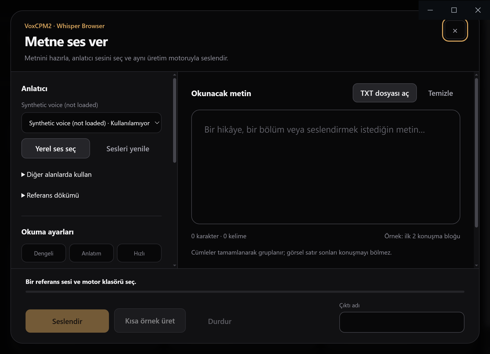
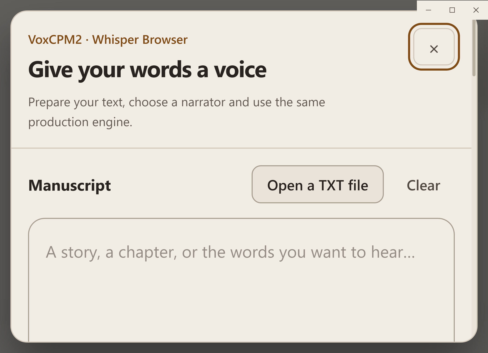
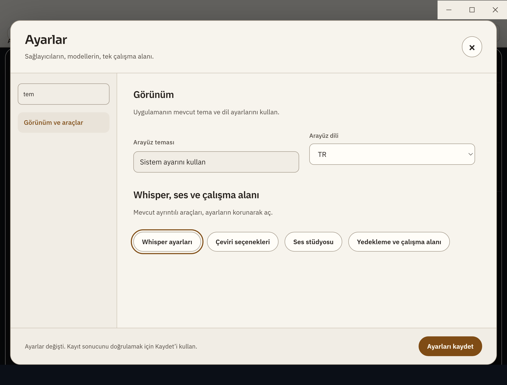
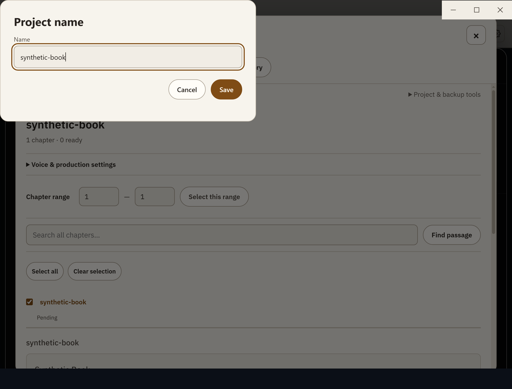

# R818–R823 doğrulama ve düzeltmeler

Başlangıç: `3dee62d3`. Bu teslim yeni altı rapordaki **19 bulguyu** kapsar. Önceki R815/R817 düzeltmeleri yeniden sayılmadı. Tarihsel denetim belgeleri değiştirilmedi.

| Rapor | Düzeltilenler |
|---|---|
|R818 — 3|%200 büyütmede ses stüdyosu gövdesine erişim; modal açıkken arka oyuncuya Backspace sızıntısı; dil değişiminde odağın kaybolması|
|R819 — 3|Kitap onaylarının erişilebilir adı/açıklaması; native asistanın modal Kaydet düğmesini örtmesi; ayar alanlarının eski dilde kalması|
|R820 — 3|WebVTT satır içi kelime zamanlarının kaydırılması; null workflow/adımların ayar geri yüklemesini kesmesi; yalnız türü eksik metadata kaydının atlanması|
|R821 — 3|Arka plandaki işi global iş merkezinden durdurma; temiz üretimden sonra eski düşük güven raporunun kalması; dolu sağlayıcı kapsamına model eklenirken sessiz kayıp|
|R822 — 4|Türkçe I/ı ile kayıtlı sayfa araması; bitişik cue kelime sahipliği; eski hedefin yeni klip sanılması; taşınan dosyanın izleme kimliği/konumu|
|R823 — 3|Diğer kartın veya geciken kaydın not taslağını silmesi; farklı hedef dile yanlış dizi sözlüğü; uzun paragrafın sonunun çeviriden düşmesi|

Kimlik, neden, kaynak ve test eşlemesi [status.json](status.json); ayrıntılı sınırlar ve ölçümler [validation.json](validation.json).

## Önemli davranışlar

- Klip önce aynı diskte kendine ait geçici alana indirilip hazırlanır; başarıdan sonra hedef atomik değiştirilir. Gerçek yt-dlp/FFmpeg kontrolünde eski 2 saniyelik hedef yerine istenen 10 saniyelik klip geldi. Hata/iptal eski sağlam dosyayı korur.
- Bilinmeyen dilli eski dizi profili silinmez. Taslak olarak görünür; kullanıcı bu hedef dil için açıkça onaylayana kadar zorunlu sözlüğe eklenmez. TR/DE profilleri birbirini ezmez.
- Paragrafın tam metni mevcut 6000 karakterlik istek bütçesi içinde korunur; API hedefleri en fazla 2000 karakterlik güvenli parçalara ayrılır. URL/yer tutucu bölünmez. Tüm yanıt parçaları olmadan DOM tam paragrafla değiştirilmez. 6000 üzeri metin sessizce kesilmez; kaynak görünür kalır ve eksiklik açık bildirilir. Tek korumalı belirteç 2000 karakterden uzunsa güvenli hata verilir; sınır yükseltilmez.
- Kaynak kısa metinden aşırı uzun metne değiştiğinde eski kimlik/çeviri emekliye ayrılır. Eski gecikmiş yanıt uygulanamaz; arşivin yeni eksik snapshot'ı complete:false olarak kaydedilir. Bağımsız geçmiş snapshot'lar silinmez.
- Metadata zamanlayıcısı ve tamamlayıcı aynı eksiklik tanımını kullanır; yeni FTS indeksi var olan sayfaları da taşır ve özgün görüntü metnini korur. Paket taşımada kanonik file: kimliği konum/hız tercihleriyle birlikte eşlenir; çakışma yazmadan önce reddedilir.

## Doğrulama

- Son birleşik hedefli Node grubu: **40/40 geçti, 0 atlama**. Ayrı Python grubu: **5/5 geçti**. Alt fixture'ların iç sayıları bu 40 ile tekrar toplanmadı.
- Değişen 39 JS/Python dosyasının syntax kontrolü geçti. Kapsam ve determinizm denetimlerinin eşikleri değiştirilmedi; yeni helper'a doğrudan test eklendi, kör zaman beklemeleri gerçek observer olayını beklemeye çevrildi.
- Gerçek Windows Electron 43.5.0 / Chromium 150: **30 görüntü**, TR/EN × açık/koyu × %100/125/150/200; native klavye, modal yığını ve Chromium AX onay adı/açıklaması. Harness normal app.exit ile işletim sistemi exit 0 verdi. Kişisel uygulamaya dokunulmadı.
- Gerçek SQLite yükseltmesi, disk/store yeniden açma, Python ZIP taşıma, FFmpeg klip üretimi ve dosya/iptal bütünlüğü sınandı. Sağlayıcı yanıtları kontrollüydü; gerçek LLM/GPU ses kalitesi veya canlı site kabulü yapılmadı.
- Tam npm test ve CI sonucu beklenmedi. Önceki açık R815-B63 bu 19 bulgunun içinde değildir ve açık kalır. Eski raporların ayrı önerileri bu teslimde tümüyle yapılmış sayılmaz.

## Seçilmiş görseller

