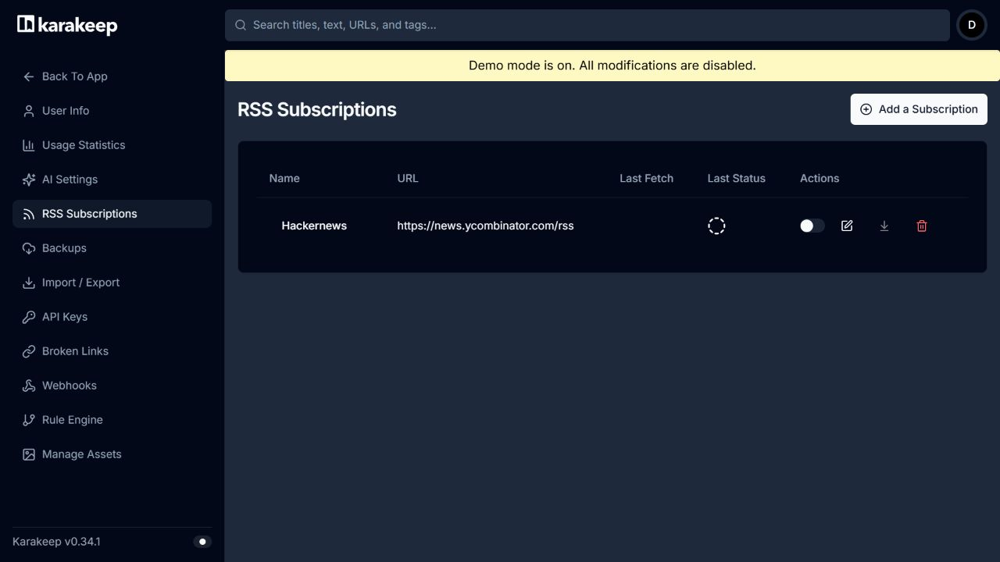
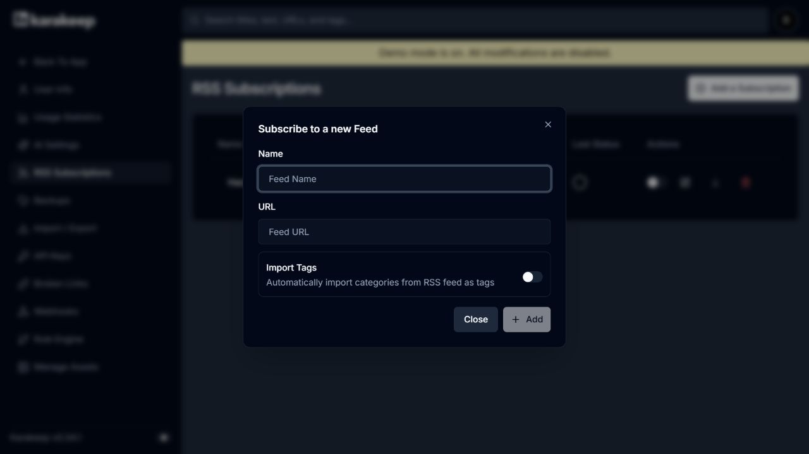
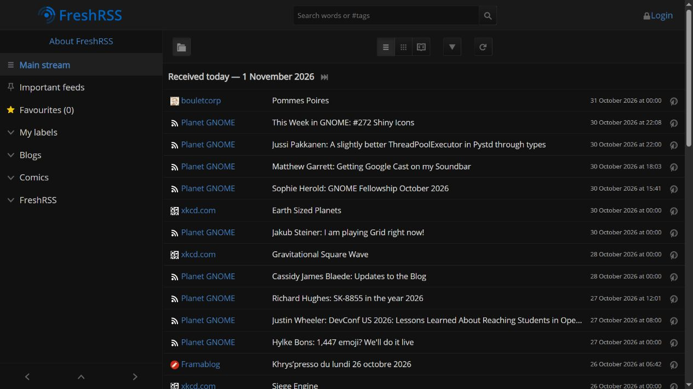
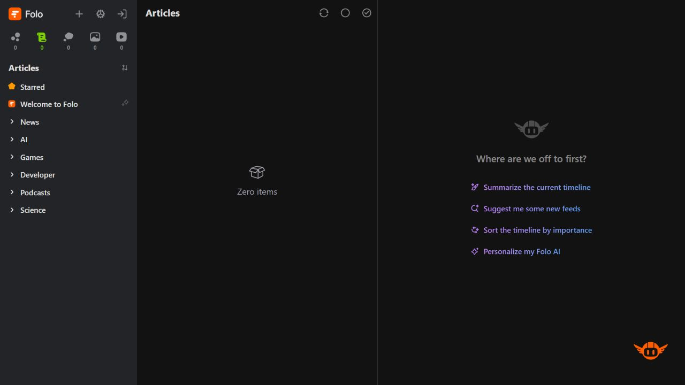
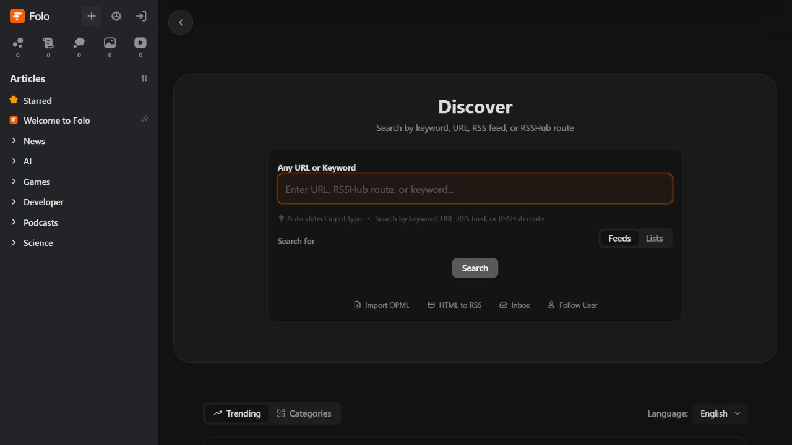
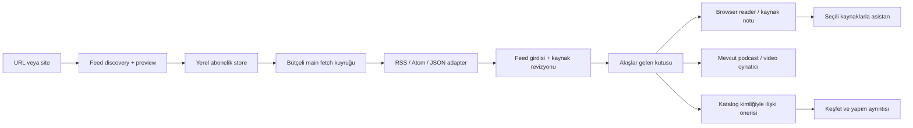

# R842 RSS sayfası — medya kütüphanesine bağlı Akışlar

**Araştırma ve uygulanacak tasarım sözleşmesi; ürün implementasyonu değildir.** Kullanıcı bu belgeyi ana geliştirme sohbetine taşıyabilir. Yerel ürün tabanı `df972383ab5a9b736b832ba64401b206beb6dedc`. Bu sayfa bir haber okuyucu kopyası değil, **yeni medya ve onun etrafındaki eleştiri/röportaj/podcast kaynaklarını kişisel kütüphaneye bağlayan gelen kutusu** olmalı.

Kaynaklar: Karakeep, FreshRSS, Miniflux, Folo, RSSHub, RSS Guard, rss-parser. [Tam HEAD ve lisans metadata'sı](repositories.json), [74 indirilen dosyanın hash/permalink kaydı](source-manifest.json), [seçilmiş fonksiyonların haritası](sources.md). Karakeep kullanıcı tarafından özellikle yeniden istendiği için bu tur RSS mekanizması derin incelendi; yeni repo keşfi sayılmadı. R76'da RSS autodiscovery/rss-parser/enclosure genel fikri zaten vardı; burada o fikir tekrar yeni sayılmıyor. **Aşağıdaki26 karar, tek RSS özelliğinin uygulama kararlarıdır;26 bağımsız yeni büyük özellik değildir.**

## Önce mevcut uygulama: sıfırdan başlamıyoruz

- `subscription-feed.js` YouTube Atom girdi ayrıştırıcısı; en fazla200girdi, alan başına4000karakter. `main.js` `subs:rssFeed` kanal ID'sinden URL kurar;30kanal/4işçi/256KB/8sn sınırları ve redirect domain doğrulaması var. Bu genel site RSS servisi değildir.
- `subscriptions-io.js` YouTube abonelikleri için OPML dışa aktarabiliyor. Genel RSS abonelik klasör ağacı ithali bunun aynısı değildir.
- `media-shelf-service.js:podcast-add` RSS'yi çekip backend parser ile audio enclosure'ları kaydeder, önceki bölümün position/duration değerlerini eşleştirir. Podcast oynatmayı veya RSS'den ses almayı yeniden icat etmiyoruz.
- `browser-reading-list.js` MHTML; not/kaynak/ankraj; katalogda film kimlikleri; asistan kaynak ve iş kimlikleri mevcut. Yeni sayfa bunlara bağlanmalı. [Yerel8dosya tabanı](local-baseline.json).

Üç nesne ayrılmalı: **Feed aboneliği → gelen feed girdisi → kullanıcının seçerek kalıcı kütüphane/kaynak kaydına aldığı içerik.** Akışta bir filmin incelemesi gelmesi o filmi izlenmiş veya dosyası mevcut yapmaz. Makaleyi okumak filmi izlemek; fragmanı oynatmak filmin kendisini izlemek değildir.

## Gerçekte bağlantıları nasıl çekiyorlar?

### Karakeep: besleme girdisinden yer imine giden sunucu hattı

`feedWorker.ts` saatlik cron ile enabled feed'leri bulur, feed ID'den dakika offset'i üretip saat içine dağıtır. Feed+saat idempotency key'iyle kuyruklar. Runner concurrency1/30sn timeout; HTTP çağrısı5sn timeout ve RSS/XML Accept ile `fetchWithProxy` kullanır. Bu Electron renderer'da çalışan bir fetch değildir. [K1](sources.md#k1)

Bu HEAD'deki worker yalnız HTTP200ve XML içerik türünü kabul edip `response.text()` okur. JSON Feed veya conditional304bu yolun hazır yeteneği değildir. `parseFeedItems` rss-parser ile XML'yi ayrıştırır; id/link/guid/title/categories şemasını doğrular; kimlik sırası **guid → id → link**. Kategoriler string veya `{_: string}` biçiminden normalize edilir. [K2](sources.md#k2)

Worker feed+entryID ithal kayıtlarını sorgular, yeni GUID ve link taşıyan girdileri `bookmarks.createBookmark` ile `source: rss` olarak oluşturur. İsteğe bağlı kategorileri tag yapar; import tablosuna bookmark ID veya başarısızsa null yazar. Son feed fetch başarısı, her bookmark/tag işleminin başarısı demek değildir. Bu yüzden bizde **çekildi/ayrıştırıldı/içe alındı/eksik kalan** ayrı sayılmalıdır. Upstream'in yorumunu veya log satırını eksiksiz retry garantisi saymıyoruz. [K1](sources.md#k1)

`FeedsService` kullanıcı sahipliği ve kota; repo kalıcılık; settings UI ad/URL/enabled/importTags sunar. Listeden RSS yayımlama ise bambaşka bir çıkış hattıdır: RSS route liste içeriğini yetki/token sözleşmesiyle alır, `toRSS` link/asset girdileri, tag/date/author üretir; text note'ları aynı biçimde dışarı vermez. **RSS tüketme ile kendi koleksiyonumuzu RSS yayımlama iki ayrı ürün kararıdır.** [K3](sources.md#k3) / [K4](sources.md#k4)

### Miniflux: URL'den gerçek beslemeyi bulma ve sağlam normalizasyon

`subscriptionFinder.FindSubscriptions` önce gelen URL'nin zaten feed olup olmadığını algılar. Değilse HTML canonical/base ilişkisini, YouTube/GitHub özel durumlarını, HTML feed linklerini, opsiyonel RSS-Bridge'i ve son olarak bilinen yolları inceler. URL girince otomatik rastgele bir beslemeye abone olmak yerine bulunan adayları kullanıcıya sunmamızın kod referansı budur. Keşifte zaten indirilen feed gövdesini/ETag'i tekrar kullanabilmesi gereksiz ikinci isteği azaltır. [M1](sources.md#m1)

`ParseFeed` RSS/Atom/JSON/RDF formatına yönlendirir. Adapter mutlak link, dil, author, kategori, title/content/date ve enclosure alanlarını ortak modele çevirir. RSS GUID'lerini tek kabul edip körlemesine güvenmez; aynı snapshot'ta çakışmaları ayırmaya çalışır. Bu yaklaşım mükemmel tarihsel kimlik garantisi değildir; bizim feed içi kimlik ve canonical kaynak kümemiz ayrı olmalıdır. [M2](sources.md#m2)

`RequestBuilder.WithETag/WithLastModified` conditional header kurar; `ResponseHandler`304/429, efektifURL, body sınırı, sıkıştırma ve hata türlerini ayırır. `processor` RSS özetini gerekirse tam sayfa içeriğiyle zenginleştirir, filtreyi ve HTML sanitization'ı uygular. Bizim ilk tercihimiz kendi Defuddle hattını kullanmaktır; Go scraping backend'ini gömmek gerekmez. [M3](sources.md#m3) / [M4](sources.md#m4)

### Folo: güzel medya arayüzü var; veri alma backend'i ayrıca gerekli

`UnifiedDiscoverForm` keyword/webURL/rsshubURI ayrımını yapar; web adresini önce discover endpoint'ine, doğrudan route/app-link'i preview'e taşır. Bu kod, her siteyi tarayan yerel feed server'ı değil; `followClient` servis çağrılarıyla çalışan istemcidir. Folo ekranını alıp backend işini çözülmüş sayamayız. [F1](sources.md#f1)

`getItemComponentByView` makale/sosyal/görsel/video/ses/bildirim için ayrı kart seçer. `useEntryMarkReadHandler` ayarlara bağlı render/scroll işaretlemesini kuyruğa verir; okuyucu durumunu içerik türüyle ilişkilendirir. Bizim medya sayfasında okundu/izlendi ayrımı ayrıca gerekir. `transformVideoUrl` bazı siteler için autoplay embed URL'si üretir; bu davranışı aynen taşımayız. Mevcut oynatıcı ve native Browser üzerinden **kullanıcının Oynat eylemiyle** açmak daha uygun. [F2](sources.md#f2) / [F3](sources.md#f3)

### RSSHub: RSS yoksa siteye özel adapter; evrensel sihirli dönüştürücü değil

RSSHub route'ları her kaynak için ayrı parametre/HTTP/parser kodu tutar; Radar route keşfine yardım eder, cache katmanı tekrar fetch'i azaltır. Letterboxd diary adapter'ı örneğinde kendi scraper'ını kurmak yerine `https://letterboxd.com/{username}/rss/` beslemesini çekip `letterboxd:watchedDate/rewatch/memberRating` gibi alanları okur. Journal RSS ve kullanıcı diary RSS aynı veri kümesi değildir. Takip edilen kişinin puanı kullanıcının kişisel puanı olmaz. [H1](sources.md#h1) / [H2](sources.md#h2)

IMDb chart route'unun varlığı bütün IMDb verisine API/erişim garantisi değildir. Site değişimi, captcha, erişim koşulu ve adapter bakımı devam eder. İlk sürümde normal RSS/Atom; sonradan kullanıcının açık seçtiği RSSHub instance/route. RSSHub tümünü zorunlu Docker servisi yapmak gereksiz. [H3](sources.md#h3)

## Önerdiğim26 sayfa/ürün kararı

S/M/L göreli büyüklüktür; süre taahhüdü değildir. Temel taşıma kararları bazı eski önerilerin bu yeni sayfaya uygulanmasıdır; yeniden keşif sayılmamalıdır.

| ID | Kullanıcı sonucu ve davranış | Kod dayanağı / alınacak parça | Öncelik |
|---|---|---|---|
| R842-01 | Site, feed URL veya RSSHub URI yapıştır; ne bulunduğunu ve hangi adresin izleneceğini gör. Bir sitedeki review/podcast feed'leri ayrı aday olsun. | M1 +F1; discovery state ve URL normalizasyonu portu. Genel autodiscovery eskiR76uzantısı. | İlk/M |
| R842-02 | Abone olmadan son 5 girdi, tür, dil, güncellik, yaklaşık sıklık ve içerik kapsamı önizlensin. | K2+F1 parse/preview; sıklık tahmini bizim sentezimiz, kesin yayın takvimi değil. | İlk/M |
| R842-03 | İlk abonelikte “şimdiden itibaren / son 20 / tüm mevcut” seç. Yıllarca eski içerik okunmamış sayısını patlatmasın. | K1+FreshRSS Feed/EntryDAO; initial cursor politikası bize ait. | İlk/M |
| R842-04 | Ana Akışlar sayfasında Tümü/Makale/Video/Podcast; kart biçimi türe uygun olsun. Sesin kapağı, videonun16:9önizlemesi; makalenin kısa başlığı. | F2 +M5 enclosure. Folo komponent modeli portu, bütün UI framework'ü değil. | İlk/M |
| R842-05 | Okunmamış, kaydedilmiş, sonra izle, kütüphanede var, izlenmiş ayrı durumlar. “Kaydet” bir film izleme olayı üretmesin. | FreshRSS EntryDAO read/favorite ve M5progress ayrı modeller. Kütüphane bağlama bizim sentezimiz. | İlk/M |
| R842-06 | Review/röportajın film kimliği eşleştirme önizlemesi: aynı adlı remake'ler karışmasın; otomatik emin olunmayan ilişki öneri kalsın. | H2film alanları +yerel catalog IDs; eşleme motoru upstream'den hazır değil. | İkinci/M–L |
| R842-07 | Film ayrıntısında “Bu yapım hakkında yeni kaynaklar”; RSS girdisinin asıl yeri Akışlar, yapımda yalnız ilişkili kısa görünüm. | K1bookmark-source+yerel katalog bağlantısı. Yeni ilişki tablosu; çift kopya yapma. | İkinci/M |
| R842-08 | Aynı makale iki feed'den gelirse tek kaynak kümesi; iki feed'in provenance'ı korunur. Aynı başlıklı farklı yazılar birleşmez. | M2GUID/kaynak fallback +FreshRSS GUID politikası; feed-entry ile canonical-source ayrı. | İlk/M |
| R842-09 | Feed kısa özetse “Özet” yaz; “Tam metni al” mevcut Browser reader'ına gider. Başarısızsa özet korunur. | M4processor +yerel Defuddle; extraction izin/kapsamı açık. | İlk/M |
| R842-10 | Seçili3makale için “ortak noktalar / çelişkiler / bu filmle ilişkisi” sor. Girdi sayısı ve kullanılan tam/özet metin önce görünür olsun. | Folo timeline AI girişinin UX'i +mevcut source-bound asistan; semantik sonuç yeni sentezdir, Folo AI backend alınmış değil. | İkinci/M |
| R842-11 | Spoiler bilinmiyor / kaynak işaretli / kullanıcı izinli durumları; izlenmemiş yapımla bağlantılı özet kapalı kalabilir. | Mevcut Letterboxd politikası; dış RSS için evrensel classifier yok. R839-A09/D841-21 derinleştirmesi. | İlk/M |
| R842-12 | Günlük/haftalık seçili kaynak özeti, okunmamış sayısının tamamını tüketmek yerine bütçeli toplama. Model çağrısından önce önizleme. | Folo AI entrypoint UX +mevcut asistan/iş sistemi; scheduler/kalite bize ait. | Sonraki/M–L |
| R842-13 | “Kütüphanemdeki filmlerle ilgili” veya “Takip ettiğim yönetmenler” filtresi; neden eşleştiği gösterilsin. | R06ilişki+mevcut kişi/katalog; kaynak tag'i kesin konu bilgisi sayılmaz. | İkinci/M |
| R842-14 | Podcast enclosure'ını mevcut oynatıcıda aç; URL sayfası, ses dosyası ve takip edilen program kimliği ayrı kalsın. | M5 +RSSGuard Qt backend olay ayrımı; Qt taşınmaz, mevcut podcast player kullanılır. | İlk/M |
| R842-15 | Podcast dinleme konumu kalsın; makale okundu ve bölüm dinlendi iki farklı sonuç. Yeni feed çekimi konumu sıfırlamasın. | M5MediaProgression +mevcut podcast position. Yeni oyuncu değil ortak ilerleme bağı. | İlk/M |
| R842-16 | OPML import önizlemesi: klasörler, yeni/mevcut/bilinmeyen adresler, seçili ithal; export abonelikleri taşır. | Miniflux OPML +Folo selection; mevcut YouTube OPML korunur. Okuma geçmişi/anahtar OPML'ye otomatik konmaz. | İlk/M |
| R842-17 | Durum ekranında son deneme/son başarılı çekim/son yeni girdi ve hata ayrı. “Yeni yok” ile “bağlantı başarısız” karışmasın. | K4feed schema +M3response types; feed sağlığı ile import sağlığı da ayrı. | İlk/S–M |
| R842-18 | Conditional fetch, feed başına yenileme aralığı, host bekleme; uyku sonrası tek sefer toparlama. | M3 +K1deterministic minute; upstreamcron masaüstüne aynen taşınmaz. B841-22/23uyarlaması. | İlk/M |
| R842-19 | Uygulama kapalıyken çalışmadığı açık; açılışta sınırlandırılmış catch-up. Gizli Windows servisi ilk sürümde gerekmez. | K1sunucu worker vsElectronyaşam döngüsü; masaüstü ürün kararı. | İlk/S–M |
| R842-20 | “Bu görünen listeyi okundu yap” yalnız snapshot'taki ID/cursor'a uygular; o sırada gelen yeni girdileri yutmaz. Undo olsun. | FreshRSS markReadFeed idMax +Folo range queue. | İlk/M |
| R842-21 | Kuralı etkinleştirmeden önce hangi girdileri etiketleyeceğini/öne alacağını gör. Toplu silme/otomatik indirme ilk kural kümesine girmez. | Folo rule-summary +Miniflux allow/block; B841-07organizasyon fikrinin RSSuyarlaması. | İkinci/M |
| R842-22 | Çok gürültülü feed'i sessize al/haftalık grupta tut; kaydedilen kaynakları silmeden aboneliği bırak. | FreshRSS Feed priority/mute/retention. Gürültüyü otomatik beğenmeme sayma. | İkinci/M |
| R842-23 | Feed adresi taşınınca abonelik kimliği, okuma durumu ve kütüphane bağları korunur; yeni host açıkça görünür. | M1EffectiveURL+K3update sözleşmesi; kalıcı redirect göçü ve geçmiş ilişki bizim tasarımımız. | İkinci/M |
| R842-24 | İstenirse film kaynak koleksiyonunu RSS/XML olarak dışa ver. Açıkça paylaşmadıkça yerel/private; yerel dosya yolları dışarı çıkmaz. | K4toRSS/route; public endpoint/token revocation ayrıca tasarlanır, ilk sürüme zorunlu değil. | Sonraki/L |
| R842-25 | RSSHub route kataloğunda kaynak dili/türü/bakım durumu; normal feed varsa onu tercih et. Giriş isteyen rota “hesapsız” diye sunulmasın. | H1/H3 +Folo discover queries. Her route'un gerçek erişimi ayrı ölçülür. | Sonraki/M |
| R842-26 | Keşfet'e “kaynaklardan gelen yapım önerileri” rafı; kaynakta geçen filmi keşif adayı yap, sahip olunan/izlenenle ilişkilendir, kullanıcı istemeden kütüphaneyi büyütme. | R06/07 +yerel discovery/catalog. HazırRSSrankeralgoritması değil, ürün sentezi. | İkinci/M–L |

## Sayfada tam olarak neler olmalı?

**Ana navigasyon:** Kütüphane, Keşfet, Akışlar, Browser; Asistan mevcut bağlam paneli olarak erişilebilir. EN varsayılan `Feeds`, TR `Akışlar`. Kütüphanenin kendi medya kataloğu RSS makaleleriyle dolmamalı. Akışlar'dan seçilen yapım Keşfet ayrıntısına, seçilen kaynak Browser/reader'a, podcast mevcut oynatıcıya gider.

**Geniş görünüm:** solda220–240px abonelik/klasörler; ortada min520px liste; sağda isteğe bağlı360px reader. İlk bakışta başlık, kaynak, yayın zamanı, içerik türü, kısa kapsam bilgisi ve kütüphane ilişkisi okunmalı. Kontrol şeridi: arama, okunmamış, tür, dil, tarih/sıralama; tek birincil eylem “Besleme ekle”. AI düğmeleri her kartta altı kez çoğalmasın; seçili kaynak eylem çubuğunda veya açık içerikte olsun.

**1160px altında:** üçüncü sütunu zorla sıkıştırma. Akış listesi ve reader aynı bölgede Liste/İçerik geçişi; asistan ayrıca açılan panel. **760px altında:** sidebar çekmece; kaynak adı+başlık öncelikli iki satır, secondary metadata kısa; klavye odağı okuyucudan geri dönüşte aynı satıra. Grafit zemin, amber tek vurgu; metin genişliği60–80karakter; beden16px civarı, yoğun liste14–15px. Bunlar hedef tasarım değerleridir; Windows150/200%DPI ve native video katmanı kabulü yapılmadı.

```text
Akışlar                    [Kaynaklarda ara…] [Okunmamış] [Besleme ekle]
───────────────────────────────────────────────────────────────────────
Tümü     42   | Makale · Sinema dergisi · 2 sa önce | Seçili kaynak
Videolar 12   | Başlık ve kısa kapsam             | Özet / Tam metin
Podcast   6   | Bu film kütüphanende · kaynak bağı| İlgili: Yapım (yıl)
Kaydedilenler | [Kaydet] [Browser'da aç]          | [Asistana sor]
──────────────|──────────────────────────────────|─────────────────────
Sinema yazıları| Video · Yönetmen röportajı       | Kaynağı aç
Röportajlar   | [Oynat] [Sonra izle]             | Kütüphanedeki yapım
Podcastler    | Süre yalnız doğrulanmışsa        | Özetin kaynağı/tarihi
Yönet          | ...                              | ...
```

Bu metin tel-kafes tasarım önerisidir, uygulamanın gerçek ekran görüntüsü değildir. İlk sürümde kartlı medya görünümü ve kompakt metin listesi yeterli; görsel duvar/sosyal timeline/bildirim görünümleri ancak gerçek kullanım gerektirirse eklenir.

### Ekleme akışı

1. URL/site/route yapıştır → bulunuyor durumu; iptal edilebilir.
2. Birden çok besleme bulunduysa başlık/tür/son girdiyle seçim. URL RSS değilse anlaşılır açıklama; güvenlik/hesap engeli “0sonuç” yapılmaz.
3. Önizleme → isim/klasör/tür/ilk ithal kapsamı/importTags tercihi. Varsayılan tag ithali kapalı; dış kategoriler kişisel etiketleri ele geçirmesin.
4. Abone ol → abonelik kaydı; ilk fetch ayrı ilerleme. Başarısız fetch aboneliğin yok olduğu anlamına gelmez. Kullanıcı adresi düzeltebilir veya silebilir.
5. İlk girdi seçimi → Kaynak kaydet / Yapımla ilişkilendir / Podcast aç. Otomatik tam sayfa arşivi, model özeti veya medya indirmesi başlamaz.

### Zorunlu durumlar

| Durum | Ekranın dürüst cevabı |
|---|---|
| Hiç abonelik yok | Sinema odaklı seçilebilir başlangıç kaynakları ve URL alanı; sahte kişisel öneri yok |
| Feed var, henüz çekilmedi | “İlk güncelleme bekleniyor”; boş içerik başarısızlık sayılmaz |
| Başarı, yeni girdi yok | Son başarılı kontrol tarihi; sayaç0 |
| Offline/429/timeout | Son içerik korunur; sonraki deneme/yeniden dene görünür |
| HTML/captcha, bozuk XML | Alınan tür ve okunamama açıklaması; sonsuz deneme yok |
| Partial import | Örneğin12girdi okundu,10işlendi,2tekrar bekliyor; feedfetchsuccess bunun üzerini örtmez |
| Özet feed | “Kaynağın özeti”; tam yazı okunmuş gibi AI cevabı yok |
| Aynı içerik güncellendi | Yeni kaynak revizyonu; okuma konumu/kişisel not sessizce silinmez |
| Abonelik bırakıldı | Feed durur; kullanıcının kalıcı kaydettiği kaynak ve film bağlantıları kalır |

## Gerçek tasarım örnekleri



Karakeep'in iyi yanı açık abonelik tablosu ve fetch/status ayrımı. Bu bir **yönetim** ekranıdır; bizim günlük medya keşif ana ekranımız aynı tablo olmamalı. Demo girdisinde fetch alanı yükleme simgesi gösterdi; başarılı fetch edildiği iddia edilmiyor. [Resmî RSS açıklaması](https://docs.karakeep.com/integrations/rss-feeds/).



Ad/URL/tag seçimi sade. Bizde buna önce URL keşfi+preview, sonra medya türü/ilk ithal kapsamı eklenmeli; ilk ekranda20ayar yığılmamalı. Form açılıp kapatıldı, kayıt yapılmadı.



FreshRSS kaynak ağacı ve yoğun taranabilir liste için iyi referans. Fakat görünür ikonların anlamı ve dar başlık kesimleri bizim tema/erişilebilirlik kabulümüze aynen taşınmaz. Teknoloji blogları demo içeriği; ürünümüz için önerilen başlangıç içerik kümesi değildir.



Folo içerik türünü navigasyonda ve seçili bağlamı asistan alanında ayırıyor. Fakat bu gözlemde timeline **Zero items**; gerçek içerik yükleme/AI kalitesi kanıtı yok. Bizde ekranın yarısını her zaman boş AI önerilerine ayırmak yerine reader/AI paneli kullanıcı isteğiyle açılmalı.



URL/keyword/route için tek giriş iyi. Bizim yerel başlangıçta bulut hesabı gerektirmeyen normal feed yolu öne çıkmalı. Folo'daki Inbox/HTML-to-RSS düğmeleri görülmüş olsa da backend/entitlement çalıştırılmadı; hazır özelliğimiz kabul edilmez. Bütün hosted build SHA'ları bilinmiyor; repo HEAD ile eşit sayılmaz. [6 görselin manifesti](../visual/manifest.json).

## Ana sohbet için önerilen teknik yapı

İlk seçenek **mevcut Electron main içinde yerel servis + kalıcı store + sınırlı worker**. Karakeep/FreshRSS/Folo backend'ini ayrı ürün olarak kurmak yerine seçilmiş parser/state desenleri alınır. Mevcut Node22.13+, SQLite/atomic write ve preload güven sınırı korunur. İlk sürümde Windows servisi, Postgres, Redis, PHP, Go veya zorunlu Docker gerekmez.



Önerilen modül isimleri **henüz mevcut dosyalar değildir**: `rss-discovery-service`, `rss-refresh-scheduler`, `rss-entry-store`, `rss-parser-adapter`, `rss-library-links`, `renderer/rss-ui`. Main IPC taslağı: `feeds:discover`, `feeds:preview`, `feeds:subscribe`, `feeds:listEntries`, `feeds:setRead`, `feeds:refresh`, `feeds:linkMedia`, `feeds:exportOpml`. Preload yalnız izinli alanları taşır; renderer keyfi URL fetch etmez.

**Veri sözleşmesi:** Feed kaydı abonelikID, original/effectiveURL, başlık/klasör, tür tercihi, enabled, ETag/LastModified, deneme/başarı/yeni-girdi tarihleri ve fetch/import durumlarını tutar. Entry kaydı feedID+externalID, sourceURL, başlık, author, published/updated/received tarihlerini, feed-body ile çıkarılmış full-body revizyonlarını ve enclosure listesini tutar. ReadState entryID'ye; LibraryLink yapımID+kanıt+onay durumuna; ImportAttempt entryID+işlem türü+duruma bağlıdır. Canonical kaynak cluster'ı entryID'nin yerine geçmez. Credentials ayrı credential store'da kalır; token içeren özel feed URL'si düz log/OPML/git'e yazılmaz.

### Kod örneği1 — aynı kaynağı daha önce gördüm mü?

Aşağıdaki kod **bu rapor için özgün örnektir**, upstream'den kopya veya ürüne eklenmiş helper değildir. ExternalID güvenilirliği ve çakışma incelemesi caller'ın sorumluluğudur; kaynağın GUID'si tekrar kullanılıyorsa sessiz overwrite yerine ayrıştırma gerekir. Linkin tümünü lowercase yapmaz, bütün query parametrelerini kör silmez.

```js
const { createHash } = require('node:crypto');

function normalizedEntryUrl(value, base) {
  if (typeof value !== 'string' || !value.trim()) return null;
  try {
    const u = new URL(value.trim(), base);
    if (!['https:', 'http:'].includes(u.protocol) || u.username || u.password) return null;
    u.hash = '';
    return u.href;
  } catch { return null; }
}

function feedEntryKey(feedId, externalId, absoluteUrl) {
  if (!feedId) throw new Error('Feed identity required');
  const nativeId = typeof externalId === 'string' ? externalId.trim() : '';
  const identity = nativeId ? ['native', nativeId] : ['url', absoluteUrl];
  if (!identity[1]) throw new Error('Entry needs a stable identity');
  return createHash('sha256').update(JSON.stringify([feedId, ...identity])).digest('hex');
}
```

Fallback olarak başlık+tarih hash'i kullanmak mümkün ama başlık güncellemesi kimliği değiştirebilir; bunu garanti gibi sunmamak gerekir. Feed içindeki aynı GUID/farklıURL, aynıURL/yeni yazı ve feed taşınması için kimlik politikası ayrı kabul senaryolarıdır. RSS GUID bir URL olmak zorunda değildir. [RSS2spec](https://www.rssboard.org/rss-specification), [AtomID ve ilişkiler](https://www.rfc-editor.org/rfc/rfc4287), [JSONFeed1.1](https://www.jsonfeed.org/version/1.1/).

### Kod örneği2 — fetch sonucu ile parse/commit sonucunu ayır

Bu **adapter arayüzü örneğidir; drop-in production kod değildir**. `io` fonksiyonları mevcut uygulamanın main ağ/store katmanına bağlanacaktır. `fetchValidated` her redirect/DNS/ağ hedefini denetleyen, uygun proxy'yi izleyen ve credential'ı yalnız doğru origin'e veren implementasyon olmalıdır. Sadece `new URL` güvenlik kontrolü yerine geçmez. `readLimitedText` çözülen/sıkıştırmadan çıkan gövdeyi sınırlamalıdır; parser için worker/CPU bütçesi ayrıca gerekir.

```js
async function refreshFeed(feed, io, signal) {
  const headers = { Accept: 'application/rss+xml, application/atom+xml, application/feed+json' };
  if (feed.etag) headers['If-None-Match'] = feed.etag;
  if (feed.lastModified) headers['If-Modified-Since'] = feed.lastModified;
  const res = await io.fetchValidated(feed.effectiveUrl, { headers, signal });
  if (res.status === 304) {
    await io.recordCheck(feed.id, { state: 'unchanged', checkedAt: io.now() });
    return { state: 'unchanged', inserted: 0 };
  }
  if (res.status !== 200) {
    await io.recordFailure(feed.id, { status: res.status, checkedAt: io.now() });
    return { state: 'failed', status: res.status };
  }
  const text = await io.readLimitedText(res, { maxBytes: 2_000_000, signal });
  const parsed = await io.parseDownloadedFeed(text, res.effectiveUrl, signal);
  // Parse/validation must finish before validators advance. A failed parse is retryable.
  const committed = await io.commitFeedSnapshot({
    feedId: feed.id, entries: parsed.entries, effectiveUrl: res.effectiveUrl,
    etag: res.headers.get('etag'), lastModified: res.headers.get('last-modified'),
    fetchedAt: io.now(),
  });
  return { state: 'updated', ...committed };
}
```

`commitFeedSnapshot` aynı feed+entryID için upsert, read-state koruma, başarılı import ile başarısız attempt'i ayırma ve bounded transaction yapmalıdır. Bu örnek scheduler/retry/exception UI'sını tamamlamaz. Paket olarak rss-parser'ın `parseString` yolu uygun XML pilot adayıdır; onun `parseURL` ağ yolunu otomatik kullanmayız. İncelenen kaynak package3.13.0ve Node>=18bildiriyor, `xml2js` transitif bağımlılığı var. JSONFeed için rss-parser'a varmış gibi davranılmaz; ayrı JSON adapter veya Miniflux yaklaşımından seçilmiş port gerekir. [P1](sources.md#p1)

### Kod örneği3 — DOM'a yalnız metin ve yetkili eylem

```js
function createFeedEntryRow(entry, actions) {
  const row = document.createElement('article');
  const title = document.createElement('h3');
  title.textContent = entry.title || 'Untitled';
  const source = document.createElement('p');
  source.textContent = `${entry.sourceName} · ${entry.kindLabel}`;
  const open = document.createElement('button');
  open.type = 'button';
  open.textContent = 'Open source';
  open.addEventListener('click', () => actions.openEntry(entry.id));
  row.append(title, source, open);
  return row;
}
```

Örnek etiketler İngilizcedir; ürün adapter'ı EN/TR sözlüğüne bağlar. Feed HTML'si `innerHTML` ile bu satıra basılmaz. Tam reader render'ı ayrı sanitizer/CSP sözleşmesi ister. `actions.openEntry` renderer'ın ham dosya/URL açma yetkisi değil, main'de ID ile çözülen izinli eylemdir.

## Gerçek başlangıç kaynakları ve canlı kontrol

**Criterion Current:** [resmî feed](https://www.criterion.com/feeds/current); **The Daily:** [resmî feed](https://www.criterion.com/feeds/the-daily). İkisi de kendi sitesindeki RSS duyurusundan bulunup bu tur HTTP 200 ile indirildi; XML parser iki snapshot'ta20'şer item gördü. Bu yalnız o anki fetch/parse kanıtıdır; gelecekte sürekli erişim, bütün görseller, tam metin, oyuncuda oynatma veya ticari yeniden yayın hakkı kanıtı değildir. [Duyuru](https://www.criterion.com/current/posts/8138-history-lessons), [HTTP/hash gözlemleri](live-feed-observations.json).

**Letterboxd Journal:** [resmî sayfa](https://letterboxd.com/journal/) footer'ı [RSS adresini](https://letterboxd.com/journal/rss/) yayımlıyor. Web aracı XML MIME türünü desteklemedi; HTTP/parser kabulünü ayrıca yaptığımız iki Criterion feed'iyle aynı seviyede doğrulanmış saymıyorum. Kullanıcı diary RSS yolu RSSHub kodunda görüldü, gerçek kişisel hesap çağrısı yapılmadı.

Başlangıç paketleri: film eleştirisi/yönetmen röportajı/festival-kürasyon/video essay/film podcast. Kullanıcı kaynakları seçer; uygulama otomatik onlarca abonelik kurmaz. Kaynaklar ülke/dil ve erişim durumu ile etiketlenir. Röportajı izleme, yorum yazısını okuma ve filmin kendisini izleme ayrı medya ilişkisidir. RSS paylaşılması kaynak içeriğini uygulamanın içeriği gibi yeniden yayımlama yetkisi değildir; okuyucuda atıf/orijinal bağlantı korunur.

## Uygulama sırası ve ana sohbete aktarım

**Aşama1:** feed discovery/preview, bounded fetch, normalize/store, liste/reader, read-state, manual refresh, OPML, sağlık ve offline son içerik. Var olan YouTube/podcast hattı çalışmaya devam eder. Sessiz otomatik arşiv/model/indirme yok.

**Aşama2:** katalogla onaylı ilişki; film ayrıntısında kaynaklar; seçili kaynaklarla asistan; kütüphane ilişkili filtre; kuralların dry-run'ı. R842-26 Keşfet rafı bu bağların sonucudur; başka bir bağımsız katalog yaratmaz.

**Aşama3:** RSSHub adapter seçimi, bütçeli digest ve isteğe bağlı koleksiyon feed export/paylaşım. Hesaplı servis, newsletter inbox ve HTML-to-RSS daha sonra ayrı değerlendirilir; Folo'daki düğme görünümü bunların yerelde hazır olduğunu kanıtlamaz.

İlerideki kısa kabul kümesi: aynıfeed2çekim tek kayıt; GUIDçakışması;304sonrası girdi/read-state korunması;200bozukXMLsonrası validator ilerlememesi;redirect sonrası doğruyetki;ZIP/decodebodylimiti;TRUTCgünsınırı;feedtaşınması;okundu-topluişlem sırasında gelen yenigirdi;göreviptali;makaleyiokuma≠filmizleme;remakeIDonayı;enclosureA/Vayrımı;podcastkonumukoruma;darWindows/DPI ve EN/TR. **Bunlar bu tur ürün testinde geçmiş değildir.**

Ana sohbetin ilk uygulama paketi olarak R01–05/08/09/14–20'yi birlikte almasını öneririm: çalışan, ölçülebilir bir RSS gelen kutusu. Sonra medya ilişkisi ve asistan. Kullanıcı arayüzünün tek başına yetişip fetch/state hattının eksik kalması veya sırf backend hazır diye uyumsuz yönetim tablosunun teslim edilmesi kabul sayılmamalı.

## Edinim kararı ve sınır

Karakeep/FreshRSS/Folo/RSSHub AGPL; Miniflux Apache2; rss-parser MIT; RSSGuard GPL3. Folo `icons/mgc` yeniden dağıtım istisnası dışarıda tutulmalı, kendi ikon setimiz kullanılmalı. FreshRSS `lib/http-conditional.php` kök AGPL'den farklı **CC BY-SA2.0FR** başlığı taşıyor; onu genel AGPL/MIT helper sanıp kopyalamayız. Koşullarıyla seçilmiş kod portu ve davranışın bağımsız uyarlanması pratik seçeneklerdir; bütün servis/platformları değiştirmek gerekmiyor.

Upstream build/installer, gerçek Windows native RSS sayfası, canlı AI/digest, kişisel Letterboxd, ses oynatma/DRM,200feedsoak bu araştırmada çalıştırılmadı.6 gerçek public/onboarding ekranı,2 publicXMLfetch/parse ve74 kaynak dosya incelemesi ayrı kanıtlardır. Raporun kod örnekleri uygulamaya eklenmedi; burada bir UI veya servis teslim edilmiş gibi sunulmuyor.
